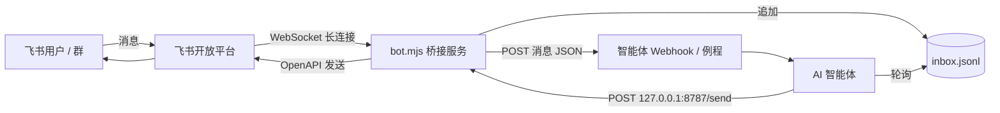

# feishu-agent-bridge

让**任何 AI 智能体**接入飞书 / Lark 的轻量桥接服务：扫码一键创建机器人，WebSocket 长连接收消息（无需公网 URL），收到消息后用 Webhook 叫醒你的智能体，智能体再通过本机 HTTP 接口回复文字、文件和图片。

> English summary at the [bottom](#english).

## 特性

- **扫码创建应用**：`register.mjs` 生成二维码（PNG + 链接），用飞书 App 扫码即可创建自建应用，凭据自动写入 `.env`（权限 600）
- **长连接收消息**：私聊直接收；群聊需 @ 机器人；不需要公网服务器或回调地址
- **inbox.jsonl**：每条入站消息追加一行 JSON，方便轮询
- **主人白名单 + 访客模式**：`isOwner` / `guestMode` 字段让智能体区分主人和其他人
- **Webhook 唤醒**：收到消息把整条 JSON POST 给你的智能体平台，请求头可配置
- **本机接口**（只绑定 `127.0.0.1`）：`POST /send`（Markdown 文本 / 文件 / 图片 / 引用回复）、`POST /download`、`GET /health`
- **安全守护**：`run-loop.sh` 崩溃自动重启；`stop.sh` 只停止自己记录的 PID，不会误杀其他进程
- 日志自动对密钥脱敏

## 架构



## 快速开始

需要 Node.js ≥ 20、`curl`、`jq`（`send.sh` 用）。

```bash
git clone https://github.com/hetao950205/feishu-agent-bridge.git
cd feishu-agent-bridge
npm install
cp .env.example .env && chmod 600 .env   # 按需改 FEISHU_BOT_NAME 等；凭据可留空
# 删除 .env 里示例的 LARK_APP_ID / LARK_APP_SECRET 两行，让扫码流程写入真实值
node register.mjs                         # 打开 feishu-qr.png 或 qr-url.txt 里的链接，用飞书扫码
```

扫码确认后，凭据写入 `.env`，扫码人的 open_id 写入 `owner-open-id.txt`，并自动执行 `start.sh` 启动机器人。

```bash
curl -s http://127.0.0.1:8787/health      # ok: true 即已连接
# 把 owner-open-id.txt 中的值填进 .env 的 FEISHU_ALLOWED_OPEN_IDS，然后重启
./start.sh
```

在飞书里给机器人发一句话，`inbox.jsonl` 里应出现一条记录。

已有应用？直接在 `.env` 里填 `LARK_APP_ID` / `LARK_APP_SECRET`，然后 `./start.sh`（需在开发者后台把事件订阅方式设为「长连接」并订阅 `im.message.receive_v1`）。

## 配置

完整说明见 [`.env.example`](.env.example)。

| 变量 | 说明 | 默认 |
|---|---|---|
| `LARK_APP_ID` / `LARK_APP_SECRET` | 应用凭据（扫码后自动写入） | — |
| `LARK_DOMAIN` | 国际版 Lark 填 `lark` | 飞书 |
| `FEISHU_BOT_NAME` / `FEISHU_BOT_DESC` | 扫码创建时的应用名 / 简介 | `AI Agent` |
| `FEISHU_PAIRING_ACK` | 配对模式下首条私聊的自动回执 | `已收到，AI Agent 会尽快回复你。` |
| `FEISHU_BRIDGE_PORT` | 本机接口端口（固定绑定 127.0.0.1） | `8787` |
| `FEISHU_ALLOWED_OPEN_IDS` | 主人 open_id，逗号分隔；空 = 配对模式 | 空 |
| `FEISHU_WAKE_URL` / `FEISHU_WAKE_KEY` | 唤醒 Webhook 地址与密钥 | 空（不唤醒） |
| `FEISHU_WAKE_KEY_HEADER` | 密钥放哪个头；`Authorization` 时加 `Bearer ` | `Authorization` |
| `FEISHU_ALLOWED_FILE_DIRS` | `/send` 可读取的额外目录 | 本目录 + `/tmp` |
| `FEISHU_QR_PNG` | 二维码 PNG 路径 | `./feishu-qr.png` |
| `REGISTER_MAX_ROUNDS` | 二维码过期自动重发轮数 | `6` |
| `NODE_BIN` | `run-loop.sh` 使用的 Node bin 目录 | 系统 PATH |

## 入站消息格式

`inbox.jsonl` 每行、以及 Webhook 请求体都是同一个 JSON：

```json
{
  "timestamp": "2026-01-01T12:00:00.000+08:00",
  "chatId": "oc_xxx", "chatType": "p2p",
  "messageId": "om_xxx", "rootId": null,
  "adapterThreadId": "lark:oc_xxx:om_xxx",
  "senderOpenId": "ou_xxx", "senderName": "张三",
  "contentType": "text", "text": "你好",
  "mentionedBot": false, "resources": [],
  "isOwner": true
}
```

非白名单发送者额外带 `"guestMode": true`（以及兼容字段 `"ignored": "guest_mode"`）——**不是丢弃**，智能体同样应回复，但要遵守访客规则。

## 本机接口

```bash
# 文字（Markdown）
echo '**你好**' | ./send.sh oc_xxx
REPLY_TO=om_xxx ./send.sh oc_xxx reply.md
# 文件 / 图片
./send.sh oc_xxx --file ./report.pdf
./send.sh oc_xxx --image ./chart.png

# 原始 HTTP
curl -s -X POST http://127.0.0.1:8787/send -H 'content-type: application/json' \
  -d '{"chatId":"oc_xxx","text":"markdown 内容","replyTo":"om_xxx"}'
# 也可用 threadId: "lark:oc_xxx:om_root" 代替 chatId

# 下载对方发来的附件（fileKey 来自 resources）
curl -s -X POST http://127.0.0.1:8787/download -H 'content-type: application/json' \
  -d '{"messageId":"om_xxx","fileKey":"file_v3_xxx","type":"file","savePath":"/tmp/in.pdf"}'

curl -s http://127.0.0.1:8787/health
```

## 接入不同的智能体平台

1. **Webhook 唤醒（推荐）**：平台若支持「收到 HTTP 请求就运行智能体」（例程 / 自动化 / serverless 函数 / Agent API），把地址填 `FEISHU_WAKE_URL`，密钥填 `FEISHU_WAKE_KEY`。若平台用自定义头（如 `X-Api-Key`），设置 `FEISHU_WAKE_KEY_HEADER=X-Api-Key`。唤醒失败只记日志，不影响收消息。
2. **轮询 inbox.jsonl**：没有 Webhook 能力的智能体（本地 CLI 智能体、定时任务）可以定时读取 `inbox.jsonl` 新增行（自行记录已处理的 `messageId`）。
3. **回复**：任何能执行 shell 或发 HTTP 的智能体都能调用 `send.sh` 或 `POST /send`。智能体必须与桥运行在同一台机器上（或通过你自己的安全隧道），因为接口只监听 127.0.0.1。

多个智能体共用一台机器时：每个智能体使用独立的飞书应用、独立目录和不同端口。

## 智能体提示词模板

见 [`docs/agent-prompt.md`](docs/agent-prompt.md)，把 `【】` 占位替换成自己的值后放进智能体的系统提示或技能说明。

## 飞书权限与排障经验

扫码创建会预配一批权限，但以下几项经常缺失（在开发者后台「权限管理」开通，**改完需创建版本并发布**才生效）：

| 现象 / 需求 | 需要的 scope |
|---|---|
| 读群信息报 `99991672` | `im:chat`、`im:chat:readonly`、`im:chat.group_info:readonly`、`im:chat.members:read` |
| 发文件 / 图片 | `im:resource` |
| 创建飞书云文档（readonly / write_only 不够） | `docx:document:create` |
| 给文档加协作者 / 转交所有权 | `docs:permission.member:create`、`docs:permission.member:transfer`、`docs:permission.member:retrieve` |
| 修改应用头像 / 基本信息 | `application:application:patch`，之后要创建版本并发布 |
| 机器人进外部群 | 开发者后台开启「对外共享 / 允许加入外部群」；灰度期可能需要企业或个人认证 |

其他：
- 缺权限时 OpenAPI 错误里通常带一个 `open.feishu.cn/app/<app_id>/auth?q=...` 授权链接，发给管理员在浏览器里开通；智能体不应替人点同意。
- `/health` 显示未连接 → 查看 `bot.log`，确认后台事件订阅方式为「长连接」，再 `./start.sh`。
- 对方发来的文件打不开，可能是企业防泄密加密包装，请对方改发 PDF。
- 二维码约 10 分钟过期，`register.mjs` 会自动换新码（最多 `REGISTER_MAX_ROUNDS` 轮）。

## 安全须知

- **主人 vs 访客**：白名单内为主人，可使用主人的私有资料和能力；访客可以正常获得帮助，但智能体**不得**读取或透露主人隐私、不得替主人执行不可逆操作（对外发信、删除、付款、授权等）。
- **永远不要暴露端口**：本机接口没有鉴权，代码中固定绑定 `127.0.0.1`。不要用反向代理或端口转发对外暴露。
- **密钥**：`.env` 权限 600 且已在 `.gitignore`；日志自动脱敏 `LARK_APP_SECRET` 和 `FEISHU_WAKE_KEY`。不要把密钥贴进聊天或提交到仓库。
- `inbox.jsonl` 和 `bot.log` 包含聊天内容与用户 ID，已被 `.gitignore` 排除，请勿分享。
- `/send` 只能读取 `FEISHU_ALLOWED_FILE_DIRS` 中的目录，避免智能体被诱导外发任意文件。

## 文件说明

| 文件 | 作用 |
|---|---|
| `register.mjs` | 扫码创建应用，写入凭据 |
| `bot.mjs` | 长连接收消息、Webhook 唤醒、本机 HTTP 接口 |
| `lib.mjs` | 日志（脱敏）、`.env` 读写 |
| `send.sh` | `/send` 命令行封装 |
| `start.sh` / `stop.sh` / `run-loop.sh` | 启动、按 PID 停止、守护重启 |

---

## English

**feishu-agent-bridge** connects any AI agent to Feishu / Lark.

- `node register.mjs` – scan a QR code in the Feishu app to create a bot app; credentials are saved to `.env` (mode 600).
- `./start.sh` – connects over a WebSocket long connection (no public URL needed). Every DM or group @-mention is appended to `inbox.jsonl` and optionally POSTed to `FEISHU_WAKE_URL` (key sent in a configurable header, default `Authorization: Bearer <key>`).
- Your agent replies through the localhost-only API: `POST 127.0.0.1:8787/send` (markdown text, file, image, `replyTo`), `POST /download`, `GET /health`, or the `send.sh` wrapper.
- `FEISHU_ALLOWED_OPEN_IDS` marks owners; other senders are flagged `guestMode: true` so your agent can help them without exposing the owner's private data.
- Never expose the port, never commit `.env`. Common missing scopes: `im:chat*` (error 99991672), `docx:document:create`, `docs:permission.member:*`, `application:application:patch` (publish a new version after changes).

Agent prompt template: [`docs/agent-prompt.md`](docs/agent-prompt.md). License: MIT.
